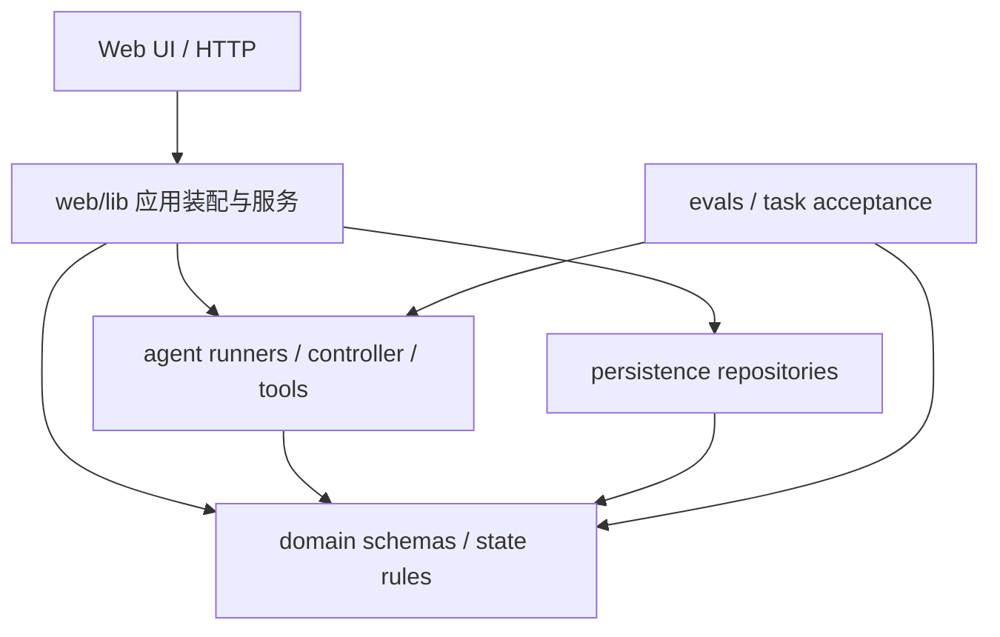

# Pitchroom harness 与架构审查

日期：2026-11-09。任务：PIT-99（父任务 PIT-97）。受查工程基线：`06787d6fa041cb47d93b7a677990a4e287b73939`。这是公开资料与当前源码的静态调查；未进行产品模型调用、运行可靠性实验、数据库检查或架构重构。

## 结论与两个不同对象

模型能提出架构方案、解释依赖并完成局部改造，但长期一致性需要人明确不变量，再由类型、模块边界、结构检查和独立验收维护。仅凭局部代码通过，不能证明架构健康；单凭本项目经历也不能证明 Codex 或 Claude 普遍没有架构能力。

Pitchroom 有两个不同的 harness：

1. **交付 harness**：Multica → 开发工具与工作树 → GitHub/CI → Reviewer → QA → 人工合并；管理谁能改什么、如何证明交付及何时停止。
2. **产品 agent runtime**：材料/已接受状态 → runner/tool/controller → 数据库提案 → 人工 Apply/Keep/Undo；管理产品推理与用户状态。

二者应共享可追溯原则，但不能把交付代理数量、CI通过或调度完成当成产品推理质量。替换 coding-agent 平台也不会自动修复产品应用层边界。

## 公开实践比较

以下均为维护者的一手资料，读取于 2026-11-09；它们描述特定实现，不证明普遍性能优劣。

| 参照 | 架构/控制方式 | 可以借鉴 | 不能由此推断 |
|---|---|---|---|
| [OpenAI harness engineering](https://openai.com/index/harness-engineering/) | 简短入口导航，仓库内结构化知识；自定义 lint/结构测试约束层间依赖与不变量 | 架构方向变成机器可检查的规则；错误信息指出修复位置 | 该内部项目的速度估算不能直接套到 Pitchroom；它的合并策略也不替代本项目人工门禁 |
| [Anthropic long-running harness](https://www.anthropic.com/engineering/effective-harnesses-for-long-running-agents) | 初始环境准备与后续增量编码分开；功能清单、持久进度、每次完成一小块并验证 | 有界任务与明确交接，避免每个上下文重新发现项目；完成必须有实际证据 | 作者明确保留单代理/多代理优劣这一开放问题；不是“代理越多越可靠”的证据 |
| [Aider repo map](https://aider.chat/docs/repomap.html) / [chat modes](https://aider.chat/docs/usage/modes.html) | 用符号与依赖关系选择预算内上下文；architect 模型提出修改，editor 模型落地 | 先看接口地图，再读实现；把设计判断和文件编辑区分 | 名为 architect 的角色本身不强制依赖方向，也不保证全局正确 |
| [mini-SWE-agent](https://github.com/SWE-agent/mini-swe-agent) | 核心为 model/environment/agent 的小循环，bash 动作与线性历史；动作通过独立子进程执行 | 保持控制流可理解，保留可回放轨迹，避免为每个步骤再造调度层 | 研究/issue求解基线并不提供 Pitchroom 的完整人工、产品或发布验收政策；不据排行榜声称生产可靠 |
| [OpenHands SDK](https://docs.openhands.dev/sdk/arch/overview) | Agent、Conversation、LLM、Tool、Event、Workspace、Security、Condenser 各自有边界；SDK、工具、workspace与server分包 | 执行环境、会话状态、工具协议、压缩/追踪职责明确 | 引入整套SDK并非本项目已有恢复、存储与控制器的免费替代；接入/迁移成本未测 |
| [LangGraph overview](https://docs.langchain.com/oss/python/langgraph/overview) / [persistence](https://docs.langchain.com/oss/python/langgraph/persistence) | 共享状态、节点和边组成流程，checkpoint 与跨线程 store 分开；支持暂停/恢复 | 让产品工作流、持久数据和人类决策的恢复边界显式可见 | 它不规定提示词或agent架构；不会替项目定义 Apply/Undo 语义，也不能默认安全重放外部副作用 |

共同点是清晰状态、有限动作、持久交接与可验证边界。分歧主要在核心循环有多大、哪些步骤交给模型、哪些状态放在运行时，以及是否需要远程沙箱。没有资料证明应把这些方案全叠加。

## 当前 Pitchroom 的实际结构

静态入口：[应用说明](../../pitchroom-app/README.md)、[包脚本](../../pitchroom-app/package.json)、[交付协议](PIPELINE.md)、[角色协议](../../tooling/pipeline/ROLE_GUIDE.md)、[CI](../../.github/workflows/pr-ci.yml)。

这是当前跨包 import 的静态摘要，不是完整调用图。`domain` 主要依赖本地模块与 Zod；扫描的非测试源码没有发现它反向导入 web、agent 或 persistence。agent 与 persistence 各自依赖 domain，web 负责装配。当前分包基础是存在的。

已有保障包括：

- `packages/agent/src/controller.ts:runUnderstandingAgent` 对提案做 schema、作者归属、来源证据和注入回显检查，结果停在 `review_required`。
- `packages/domain/src/workspace.ts` 及 Story/Positioning/Deck 契约区分命令、版本与显式决策；产品提案不是自动采用。
- `packages/agent/src/provider-budget.ts` 有请求预留、结算、unknown 与日志绑定；不能把它说成所有 coding-agent 会话的统一 token 上限。
- `tooling/pipeline/status.py` 与 `serial.py` 已有配置同源、暂停语义、单通道和身份/版本/证据约束。`pr-ci.yml` 包含工具、类型、单元、offline eval、DB guard、build、隔离DB和浏览器层；本次仅检查配置，未重新执行这些应用检查。

## 问题、证据与影响

| 优先级 | 观察或风险 | 源码/文档依据 | 影响与边界 |
|---|---|---|---|
| P1 | **缺少已找到的可执行应用层依赖规则** | 包依赖、CI脚本与所查 tooling 中未找到 import layering/cycle 的专用检查；`check-source.py` 重点是发布源码边界与工具行为 | 包分层目前主要靠组织方式与审阅。新增反向依赖可能类型正确但架构退化。属于本次静态搜索发现的检查缺口，不声称全库不存在任何相关保护 |
| P1 | **当前入口混入过期状态** | canonical `SOURCE_OF_TRUTH.md` 仍称 private 仓库与 baseline pilot 尚未合并；v6 README有“未实现”历史状态，当前已有应用和多次合并；`PIPELINE.md` 当前说明与历史段同文件 | 新上下文容易重新调查或读错阶段。现有 PIT-95/PIT-30 的文档/基线任务应优先承接，避免再建第三份状态真源；本轮不擅自改写历史验收 |
| P1 | **主聊天承担了过多调度与恢复解释** | 本轮之前的本地用量审计已识别重复读、状态查询与多轮子代理沟通；交付协议已有确定性状态入口 | 模型上下文持续增长，人工也难找到当前“下一步/等什么”。PIT-98采用一次交接、明确等待边界和短checkpoint；不会启用调度或替代新鲜门禁 |
| P2 | **服务装配依赖 fixture 命名的视图契约** | `apps/web/lib/persistent-workspace.ts` 导入 `FixtureState`、`agentReviewForChunks`；`readPersistentState` 把DB、事件、stale计算和视图映射装在一起 | 服务端真实数据与演示状态的类型归属混合，增加新增产品步骤的理解成本。当前代码能工作；这是演进风险，不是本轮已复现的用户故障 |
| P2 | **单项目选择写在服务函数中** | `persistent-workspace.ts:project()` 固定 `ensureProject("atelier", "Atelier pitch")` | 符合目前本地单项目原型约束；未来多项目/多租户前须显式传项目/身份并验证隔离。复用 PIT-35 相关身份决策，不把它当前判作越权漏洞 |
| P2 | **验收/交付基础设施也是复杂系统** | 基线 `packages/evals/src/task-acceptance/workflow.ts` 933行；`tooling/pipeline/serial.py` 1023行；职责覆盖容量、恢复、协议与交付 | 文件长度不是缺陷证明，但跨职责变化需要更多回归与解释。先画状态/副作用边界，按单一状态所有者切分；不为“减少文件长度”批量重构 |
| P2 | **不同 token 账本尚未统一归因** | 产品 provider budget、Multica usage、本地 Codex response usage 分属不同系统 | 无法仅靠一张任务卡知道全部协调成本。应区分cached/fresh/output、父子与审批会话及实际计价；暂不把字节、模型次数或0金额当成节省证明 |

## 建议顺序与决策边界

1. **本轮 PIT-98**：落实有界上下文读取、交接包检查、事件/期限等待与必要复验边界；只新增小工具和入口导航，不改控制器或产品架构。
2. **先对齐已有入口任务**：PIT-95/PIT-30 完成当前工程入口与状态说明，再决定历史段如何索引；保留不可变验收材料。
3. **提出一个小型架构契约，人工冻结后再实施**：domain 不依赖 web/agent/persistence；agent 与 persistence 不能反向依赖 web；客户端不能直接导入数据库/服务端provider；跨包深路径须经过显式公共接口。先列出当前允许/例外与负向样例，再选择基于现有 TypeScript 工具的检查，接入现有CI。导入方向检查不等于业务正确性或系统安全。
4. **视图契约先迁调用者再移除旧归属**：未来把持久/fixture共用的 WorkspaceView 放在独立契约位置，fake/live共享同一协议；单独验证真实状态映射、历史/Undo和来源访问。此提案本轮未实现。
5. **产品流程增加前先定义恢复语义**：如果继续加入跨进程长任务，明确节点输入/输出、持久checkpoint、命令幂等与外部调用unknown。LangGraph可作为比较，不预设更换当前技术栈。多项目/身份仍走已有产品决定。
6. **只用相同验收范围衡量后续收益**：比较一次真实有界交付的重复不变读取、无变化查询、协调回合、fresh/cached/output与总时长；独立审查缺陷、失败/未运行和人工验收不能因省token而减少。这里没有声称已获得具体节省比例。

未决：应用依赖契约/例外的人工冻结；是否以及何时扩展多项目；跨运行的计价与归因口径；公开发布新增文件的精确授权。任何这些决定都不由本报告自动批准。
