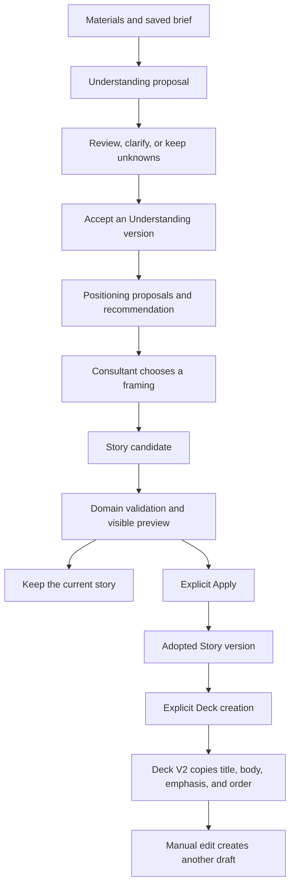

# How a proposed story becomes a saved deck

The application separates generated proposals from adopted work. A model response can be structurally valid, rejected by domain rules, accepted for preview, or explicitly adopted. These are different states.

## Where the responsibilities live

| Component | Responsibility | Source |
|---|---|---|
| Web application | Displays proposals, receives explicit actions, and reports errors | [Web package](../../pitchroom-app/apps/web/package.json) |
| Domain package | Validates references, quotation identity, unknowns, wording, and state | [Story rules](../../pitchroom-app/packages/domain/src/story.ts) |
| Agent package | Builds generation contracts and runs synthetic or live generation | [Story runner](../../pitchroom-app/packages/agent/src/story-runner.ts) |
| Story response contract | Restricts local reference IDs and generated body length | [Response contract](../../pitchroom-app/packages/agent/src/story-reference-contract.ts) |
| Persistence package | Stores durable snapshots, candidates, versions, and explicit decisions | [Persistence package](../../pitchroom-app/packages/persistence/package.json) |
| Story service | Selects local or model work and records its terminal result | [Story service](../../pitchroom-app/apps/web/lib/story-service.ts) |

The service saves the request context before generation. Story validation checks the candidate against the saved sources, accepted Understanding, selected framing, existing inputs, and prior story. An unknown reference or changed quotation can fail this check even when the provider returns completed JSON.

For a revision, saved unknowns cannot silently disappear. A model cannot label changed content as an exact human edit. These checks constrain provenance and state. They do not prove that an interpretation is persuasive or that an existing quotation supports a new conclusion.

## Why deck creation does not generate another story

Deck V2 copies the adopted Story's blocks. This gives the review boundary a concrete meaning: the consultant receives the story they adopted. A later page edit remains visible as a new draft rather than acquiring evidence support automatically.

The alternative is another model pass that reformulates the approved Story into slides. That could produce a different argument or change a caveat after approval. The current design keeps content transfer deterministic. Layout quality and client usefulness still need separate evaluation.

## Runtime boundaries

Fixture mode keeps synthetic project state in the application process and uses deterministic runners. Reload can retain that process's saved state. Restarting the fixture server creates a new in-memory project. Browser draft recovery is a different mechanism and must not be described as database persistence.

Persistent modes use PostgreSQL. Persistent Clarify work runs through a separate worker. Live mode requires provider configuration and transfer authorization. Those paths are implemented but are not exercised by this portfolio's fresh fixture walkthrough.

The source baseline is `120b82e01e1cc948f6758826c10725f889d4e3c6`. See [verification](verification.md) for actual checked behavior and omissions.
